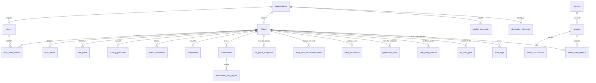

# Architecture Base de Données — Flowtym RMS (PostgreSQL 15/16 & Supabase)

> **Projet Supabase cible** : `https://aliploqizujgovnlgjvg.supabase.co`  
> **Script DDL complet & idempotent** : `src/supabase/migrations/00_complete_flowtym_schema.sql` (synchronisé avec `src/supabase/schema.sql`)

---

## 1. Vision & Principes d'Architecture

Cette architecture a été conçue pour répondre aux exigences d'un **Revenue Management System (RMS) hôtelier multi-établissements SaaS** en production :

1. **Isolation Multi-Tenant stricte (Row Level Security)** : chaque organisation (`organizations`) et chaque hôtel (`hotels`) est isolé au niveau moteur PostgreSQL via des fonctions `SECURITY DEFINER` à `search_path` verrouillé (`get_my_organization_id()`, `can_access_hotel(hotel_id)`).
2. **Séparation claire entre Référentiels Mutualisés, Flux Transactionnels et Audit Immuable** :
   - *Référentiels mutualisés* (`cities`, `venues`, `events`, `event_sources`) partagés pour éviter la duplication géographique et mutualiser la veille événementielle.
   - *Données opérationnelles tenant* (`hotels`, `room_types`, `rate_plans`, `reservations`, `otb_pace_snapshots`, `daily_rate_recommendations`, `lighthouse_rates`) strictement cloisonnées.
   - *Journalisation légale append-only* (`audit_logs`) protégée par trigger PostgreSQL (`prevent_audit_mutation`) interdisant tout `UPDATE` ou `DELETE`.
3. **Intégrité Métier Native en Base** :
   - Exclusion stricte des tarifs `sold-out` / non disponibles (`rate_eur IS NULL` dans `lighthouse_rates` et `FILTER (WHERE is_sold_out = FALSE AND rate_eur IS NOT NULL)` dans `v_compset_daily_benchmark`) afin de ne jamais fausser les médianes concurrentielles avec des `0 €`.
   - Colonnes calculées (`GENERATED ALWAYS AS`) pour `nights`, `lead_time_days`, `days_before_arrival` et `parity_gap_eur`.
   - Garde-fous tarifaires (`rate_ceiling_eur >= rate_floor_eur`, `chk_events_date_range`, `chk_res_stay_dates`).
4. **Transactions Atomiques & Outbox Pattern pour le Channel Manager (D-EDGE CRS)** :
   - La fonction RPC `apply_rm_rate_decision(...)` exécute dans une seule transaction ACID la validation humaine, la mise à jour de `daily_rate_recommendations`, l'enregistrement dans `ari_push_jobs` (avec `idempotency_key` unique) et l'insertion dans `audit_logs`.

---

## 2. Diagramme Entité-Relation (Vue Directrice)

---

## 3. Cartographie Complète des 7 Domaines (46 Tables, 4 Vues, 6 Fonctions)

### Domaine 1 — Socle Multi-Tenant & RBAC (3 tables)
| Table | Rôle | Clés & Particularités |
| :--- | :--- | :--- |
| `organizations` | Comptes groupes hôteliers | `slug` unique, `subscription_tier` (`starter`/`pro`/`enterprise`) |
| `users` | Profils utilisateurs liés à `auth.users` | `auth_user_id`, `role`, `permissions` JSONB, `allowed_hotel_ids` |
| `user_hotel_access` | Droits granulaires Utilisateur × Hôtel | `UNIQUE(user_id, hotel_id)`, flags `can_approve_rates`, `can_edit_compset`, `can_edit_rules` |

### Domaine 2 — Parc Hôtelier, Inventaire Physique & Tarifs (5 tables)
| Table | Rôle | Clés & Particularités |
| :--- | :--- | :--- |
| `hotels` | Établissements & bornes de base | `external_id` (`hotel-opera`, etc.), coordonnées GPS, `rate_floor_eur`, `rate_ceiling_eur` |
| `room_types` | Typologies de chambres (Classique, Supérieure, Deluxe, Suite) | `total_rooms`, `base_offset_eur`, `base_offset_pct`, `weight_percent` |
| `rate_plans` | Plans tarifaires & dérivations | `plan_type` (`BAR`/`NRF`/`BB`/`CORP`/`OTA_PROMO`), dérivation parent-enfant |
| `market_segments` | Segments commerciaux (Loisirs, Corporate, MICE) | `macro_segment`, `avg_commission_pct` |
| `distribution_channels` | Canaux de distribution (Direct Web, Booking, Expedia, GDS) | `commission_pct`, `distribution_cost_eur` |

### Domaine 3 — Référentiel Géographique & Veille Événementielle (11 tables)
- `cities`, `venues`, `hotel_geo_settings`, `hotel_venue_distances` (distance GPS Haversine + temps routier/transport + zone `main_10km`/`extended_30km`).
- `events`, `event_occurrences`, `event_sources`, `event_evidence`, `event_hotel_impacts`, `event_proposals` (score 30–59), `event_suggestions` (détection IA).

### Domaine 4 — Coeur PMS / CRS, OTB & Courbes de Pickup (4 tables)
- `reservations` : dossiers PMS avec `nights` et `lead_time_days` calculés automatiquement.
- `reservation_stay_nights` : ventilation nuitée par nuitée (`gross_rate_eur`, `net_rate_eur`, `distribution_cost_eur`, `is_active_otb`) permettant des agrégations ADR/RevPAR exactes.
- `otb_pace_snapshots` : snapshots historiques à J-N (`days_before_arrival` calculé) avec `pickup_1d`, `pickup_3d`, `pickup_7d`, `pickup_14d`, `pickup_30d`, annulations et turnaways.
- `dedge_inventory_days` : état temps réel importé ou synchronisé depuis D-EDGE.

### Domaine 5 — Moteur Revenue Management, CompSet, Parité & File ARI (14 tables)
- `season_calendars`, `pricing_guardrails`, `learned_calibration_rules` (apprentissage réversible).
- `daily_rate_recommendations` : grille centrale 21 colonnes (`demand_index`, `lighthouse_median_eur`, `flowtym_median_eur`, `pickup_24h`/`3d`/`7d`, `suggested_bar_eur`, `justification_epistemic` JSONB, `validation_status`, `applied_bar_eur`).
- `daily_restrictions` : MinLOS, MaxLOS, CTA, CTD, Stop-Sell par hôtel × date × typologie × plan × canal.
- `competitors`, `rate_shop_batches`, `lighthouse_rates` (nullable `rate_eur` sur `sold-out`), `rate_parity_checks` (`parity_gap_eur` calculé).
- `hotel_rms_configs`, `rm_alerts`, `rm_decision_records`, `major_event_email_alert_configs`, `major_event_email_alert_logs`, `ari_push_jobs` (Outbox CRS idempotente).

### Domaine 6 — Données Historiques, Backtesting & Audit Légal (6 tables)
- `hotel_historical_daily` (colonnes A à BZ), `hotel_historical_demand_snapshots`, `hotel_parameters_profiles`, `hotel_historical_import_logs`, `hotel_backtest_evaluations`.
- `audit_logs` : journal immuable (`before_state` / `after_state` JSONB) verrouillé contre `UPDATE` et `DELETE`.

### Domaine 7 — Administration Système (2 tables)
- `system_admin_configs`, `system_operation_logs`.

---

## 4. Vues Analytiques & Fonctions RPC Intégrées

- **`v_compset_daily_benchmark`** : agrège `min`, `PERCENTILE_CONT(0.5)` (médiane exacte), `avg`, `max` et compteur de `sold-out` en excluant systématiquement les indisponibilités.
- **`v_hotel_daily_kpi_summary`** : jointure pré-calculée pour alimenter le Flowboard et le Pricing Grid (OTB + Recommandations + Compset + Parité OTA).
- **`v_event_hotel_impact_matrix`** : croisement événements × hôtels avec distance, compression et ADR boost estimé.
- **`apply_rm_rate_decision(...)`** : RPC atomique de validation RM (mise à jour décision + création job `ari_push_jobs` + écriture `audit_logs`).
- **`haversine_distance_km(...)`** : fonction SQL pure sans dépendance d'extension PostGIS complexe.

---

## 5. Sécurité Supabase & Row Level Security (RLS)

1. **RLS activé sur 100% des 46 tables** — aucune table n'est exposée sans politique explicite.
2. **Fonctions `SECURITY DEFINER` sécurisées (`SET search_path = public`)** :
   - `get_my_organization_id()` résout l'organisation de `auth.uid()` côté serveur.
   - `can_access_hotel(p_hotel_id)` vérifie à la fois l'appartenance à l'organisation et l'autorisation spécifique sur l'hôtel (`admin`/`head_of_rm`/`allowed_hotel_ids = "all"` ou ligne explicite dans `user_hotel_access`).
3. **Immutabilité de l'audit** : trigger `trg_audit_logs_immutable` + politiques RLS `SELECT` et `INSERT` uniquement sur `audit_logs`.

---

## 6. Indexation, Performance & Scalabilité Future

- **Index composites critiques** : `(hotel_id, stay_date)` sur les grilles, snapshots et restrictions ; `(hotel_id, arrival_date, status)` sur `reservations`.
- **Index partiels ciblés** : `WHERE validation_status = 'pending'`, `WHERE status = 'active'`, `WHERE status IN ('queued', 'retrying')`, `WHERE is_active_otb = TRUE`, `WHERE parity_status IN ('undercut_minor', 'undercut_critical')`.
- **Index GIN** : sur `events.sources` pour recherche multicritères rapide.
- **Stratégie de passage à l'échelle (> 50M lignes)** :
  - Partitionnement déclaratif PostgreSQL `PARTITION BY RANGE (stay_date)` sur `reservation_stay_nights`, `otb_pace_snapshots` et `created_at` sur `audit_logs` par trimestre/année.
  - Activation de **PgBouncer (Transaction Pooling, port 6543)** côté Supabase pour les workers d'ingestion Lighthouse/D-EDGE.
